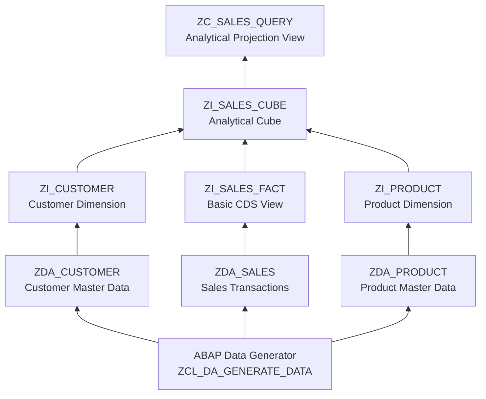
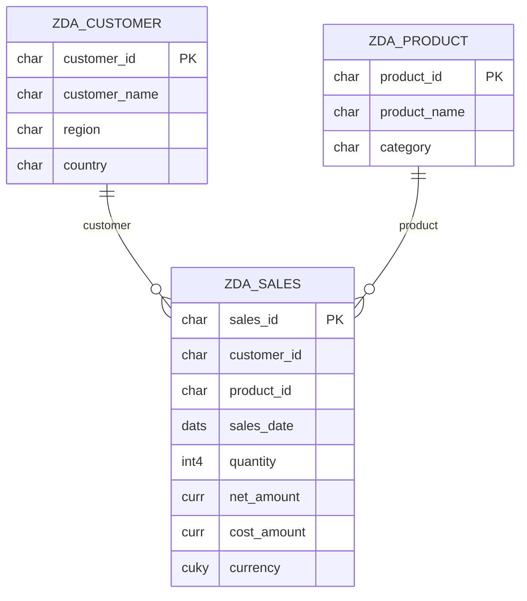

# SAP Sales Performance Analytics | ABAP CDS

An end-to-end analytical modeling project built from scratch using ABAP CDS View Entities and CDS-based Analytical Projection Views. The project demonstrates how raw transactional data can be transformed into a reusable analytical model and consumed through a multidimensional query.

## 🎯 Project Objective

Bridge SAP ABAP development and SAP Data & Analytics by implementing a complete analytical modeling scenario, from custom database tables to a business-facing analytical query.

The solution enables business users to:

- Analyze sales revenue, cost, and sold quantity.
- Compare sales performance across customers and products.
- Explore sales by transaction date.
- Dynamically drill down and filter analytical results.
- Reuse a central analytical cube for different reporting requirements.

## 🏗️ Solution Architecture



The model separates physical data storage, reusable CDS views, analytical modeling, and query consumption.

## Technologies & Tools

- ABAP Development Tools (ADT) for Eclipse
- ABAP and ABAP SQL
- ABAP Dictionary database tables
- CDS View Entities
- CDS analytical dimensions and cubes
- CDS Analytical Projection Views (`analytical_query`)
- SAP analytical engine

## Data Model

The project uses synthetic sales data for an electronics business in Egypt. Each fact record represents a sales transaction for a single product. Customer and product master data provide descriptive attributes for analytical navigation.

| Database table | Purpose | Sample records |
| --- | --- | ---: |
| `ZDA_CUSTOMER` | Customer ID, name, region, country | 3 |
| `ZDA_PRODUCT` | Product ID, name, category | 2 |
| `ZDA_SALES` | Sales ID, customer, product, date, quantity, revenue, cost, currency | 6 |

Customer-to-sales and product-to-sales relationships are one-to-many. All sample monetary amounts use EGP, and quantity represents individual pieces.

## Implementation — Step by Step

The following sections contain the complete source code for the project in dependency order. Create the objects in an SAP development or sandbox system using Eclipse ADT. The example package is `ZDA_SALES_ANALYTICS`.

### 1. Create the Database Tables

In ADT, right-click the development package and choose **New → Other ABAP Repository Object → Database Table**. Create and activate the following three tables.

#### 1.1 `ZDA_CUSTOMER` — Customer Master Data

Stores customer identifiers, names, regions and countries.

```abap
@EndUserText.label: 'Customer Master Data'
@AbapCatalog.enhancement.category: #NOT_EXTENSIBLE
@AbapCatalog.tableCategory: #TRANSPARENT
@AbapCatalog.deliveryClass: #A
@AbapCatalog.dataMaintenance: #RESTRICTED

define table zda_customer {

  key client      : abap.clnt not null;
  key customer_id : abap.char(10) not null;

  customer_name   : abap.char(60);
  region          : abap.char(30);
  country         : abap.char(3);

}
```

#### 1.2 `ZDA_PRODUCT` — Product Master Data

Stores product identifiers, descriptions and categories.

```abap
@EndUserText.label: 'Product Master Data'
@AbapCatalog.enhancement.category: #NOT_EXTENSIBLE
@AbapCatalog.tableCategory: #TRANSPARENT
@AbapCatalog.deliveryClass: #A
@AbapCatalog.dataMaintenance: #RESTRICTED

define table zda_product {

  key client     : abap.clnt not null;
  key product_id : abap.char(10) not null;

  product_name   : abap.char(60);
  category       : abap.char(30);

}
```

#### 1.3 `ZDA_SALES` — Sales Transaction Data

Stores sales transactions, customer and product identifiers, sales date, quantity, revenue, cost and currency.

```abap
@EndUserText.label: 'Sales Transaction Data'
@AbapCatalog.enhancement.category: #NOT_EXTENSIBLE
@AbapCatalog.tableCategory: #TRANSPARENT
@AbapCatalog.deliveryClass: #A
@AbapCatalog.dataMaintenance: #RESTRICTED

define table zda_sales {

  key client      : abap.clnt not null;
  key sales_id    : abap.char(10) not null;

  customer_id     : abap.char(10);
  product_id      : abap.char(10);
  sales_date      : abap.dats;
  quantity        : abap.int4;

  @Semantics.amount.currencyCode: 'zda_sales.currency'
  net_amount      : abap.curr(15,2);

  @Semantics.amount.currencyCode: 'zda_sales.currency'
  cost_amount     : abap.curr(15,2);

  currency        : abap.cuky;

}
```

Activate all three tables (`Ctrl + F3`).

#### Logical data relationships



The diagram shows logical relationships, not declared database foreign key constraints. Client fields are omitted for clarity.

| Table annotation | Purpose |
| --- | --- |
| `@AbapCatalog.tableCategory: #TRANSPARENT` | Defines a transparent database table |
| `@AbapCatalog.deliveryClass: #A` | Identifies application data |
| `@AbapCatalog.enhancement.category: #NOT_EXTENSIBLE` | Defines the table as not extensible |
| `@AbapCatalog.dataMaintenance: #RESTRICTED` | Restricts standard table data maintenance |
| `@Semantics.amount.currencyCode` | Associates an amount field with its currency reference |

### 2. Create the ABAP Demo Data Generator

Create an ABAP class named `ZCL_DA_GENERATE_DATA` in the same package. Implement `IF_OO_ADT_CLASSRUN` so that the class can be executed directly in ADT.

```abap
CLASS zcl_da_generate_data DEFINITION
  PUBLIC
  FINAL
  CREATE PUBLIC.

  PUBLIC SECTION.
    INTERFACES if_oo_adt_classrun.

ENDCLASS.


CLASS zcl_da_generate_data IMPLEMENTATION.

  METHOD if_oo_adt_classrun~main.

    DATA lt_customer TYPE STANDARD TABLE OF zda_customer
                     WITH EMPTY KEY.

    DATA lt_product TYPE STANDARD TABLE OF zda_product
                    WITH EMPTY KEY.

    DATA lt_sales TYPE STANDARD TABLE OF zda_sales
                  WITH EMPTY KEY.


    " Customer master data

    lt_customer = VALUE #(
      ( customer_id   = 'C001'
        customer_name = 'Nile Trading'
        region        = 'Cairo'
        country       = 'EG' )

      ( customer_id   = 'C002'
        customer_name = 'Delta Electronics'
        region        = 'Alexandria'
        country       = 'EG' )

      ( customer_id   = 'C003'
        customer_name = 'Upper Egypt Store'
        region        = 'Aswan'
        country       = 'EG' )
    ).


    " Product master data

    lt_product = VALUE #(
      ( product_id   = 'P001'
        product_name = 'Laptop'
        category     = 'Computers' )

      ( product_id   = 'P002'
        product_name = 'Monitor'
        category     = 'Accessories' )
    ).


    " Sales transaction data

    lt_sales = VALUE #(
      ( sales_id    = 'S001'
        customer_id = 'C001'
        product_id  = 'P001'
        sales_date  = '20260105'
        quantity    = 1
        net_amount  = 12000
        cost_amount = 9000
        currency    = 'EGP' )

      ( sales_id    = 'S002'
        customer_id = 'C001'
        product_id  = 'P002'
        sales_date  = '20260110'
        quantity    = 2
        net_amount  = 8000
        cost_amount = 5000
        currency    = 'EGP' )

      ( sales_id    = 'S003'
        customer_id = 'C002'
        product_id  = 'P001'
        sales_date  = '20260115'
        quantity    = 1
        net_amount  = 15000
        cost_amount = 11000
        currency    = 'EGP' )

      ( sales_id    = 'S004'
        customer_id = 'C003'
        product_id  = 'P002'
        sales_date  = '20260205'
        quantity    = 1
        net_amount  = 6000
        cost_amount = 4000
        currency    = 'EGP' )

      ( sales_id    = 'S005'
        customer_id = 'C002'
        product_id  = 'P001'
        sales_date  = '20260210'
        quantity    = 1
        net_amount  = 10000
        cost_amount = 7500
        currency    = 'EGP' )

      ( sales_id    = 'S006'
        customer_id = 'C001'
        product_id  = 'P002'
        sales_date  = '20260220'
        quantity    = 3
        net_amount  = 9000
        cost_amount = 6000
        currency    = 'EGP' )
    ).


    " Save data into database tables

    MODIFY zda_customer FROM TABLE @lt_customer.
    MODIFY zda_product  FROM TABLE @lt_product.
    MODIFY zda_sales    FROM TABLE @lt_sales.

    COMMIT WORK.


    " Display results

    out->write( 'Sample data generated successfully' ).
    out->write( |Customers: { lines( lt_customer ) }| ).
    out->write( |Products: { lines( lt_product ) }| ).
    out->write( |Sales: { lines( lt_sales ) }| ).

  ENDMETHOD.

ENDCLASS.
```

`MODIFY` inserts records with new keys and updates records with existing keys. This makes it possible to rerun the demo generator without duplicate primary key insert errors. It does not delete other existing records.

Activate the class and press `F9` to execute it as an **ABAP Console Application**.

Expected console output:

```text
Sample data generated successfully
Customers: 3
Products: 2
Sales: 6
```

Open Data Preview on each database table to verify the generated records.

#### 2.1 Customer master data

| Customer ID | Customer Name | Region | Country |
| --- | --- | --- | --- |
| C001 | Nile Trading | Cairo | EG |
| C002 | Delta Electronics | Alexandria | EG |
| C003 | Upper Egypt Store | Aswan | EG |

#### 2.2 Product master data

| Product ID | Product Name | Category |
| --- | --- | --- |
| P001 | Laptop | Computers |
| P002 | Monitor | Accessories |

#### 2.3 Sales transaction data

| Sales ID | Customer ID | Product ID | Sales Date | Quantity | Net Amount | Cost Amount | Currency |
| --- | --- | --- | --- | ---: | ---: | ---: | --- |
| S001 | C001 | P001 | 2026-01-05 | 1 | 12,000 | 9,000 | EGP |
| S002 | C001 | P002 | 2026-01-10 | 2 | 8,000 | 5,000 | EGP |
| S003 | C002 | P001 | 2026-01-15 | 1 | 15,000 | 11,000 | EGP |
| S004 | C003 | P002 | 2026-02-05 | 1 | 6,000 | 4,000 | EGP |
| S005 | C002 | P001 | 2026-02-10 | 1 | 10,000 | 7,500 | EGP |
| S006 | C001 | P002 | 2026-02-20 | 3 | 9,000 | 6,000 | EGP |

### 3. Create the Basic CDS View Entity

In ADT, choose **New → Other ABAP Repository Object → Data Definition**. Create the following CDS data definitions in the order shown, activating each before creating dependent views.

#### `ZI_SALES_FACT`

This basic CDS view separates physical persistence from analytical modeling. It exposes reusable business field aliases and defines currency semantics for revenue and cost.

```abap
@EndUserText.label: 'Sales Fact Basic View'
@AccessControl.authorizationCheck: #NOT_REQUIRED

define view entity ZI_SALES_FACT
  as select from zda_sales
{
  key sales_id    as SalesID,

      customer_id as CustomerID,
      product_id  as ProductID,
      sales_date  as SalesDate,
      quantity    as Quantity,

      @Semantics.amount.currencyCode: 'Currency'
      net_amount  as NetAmount,

      @Semantics.amount.currencyCode: 'Currency'
      cost_amount as CostAmount,

      currency    as Currency
}
```

**Validation:** Activate the view and open Data Preview. Expect six transaction records in a clean training dataset.

### 4. Create the Analytical Dimensions

Dimensions provide descriptive business context for analytical navigation.

#### 4.1 `ZI_CUSTOMER` — Customer Dimension

```abap
@EndUserText.label: 'Customer Dimension'
@AccessControl.authorizationCheck: #NOT_REQUIRED
@Analytics.dataCategory: #DIMENSION
@ObjectModel.representativeKey: 'CustomerID'

define view entity ZI_CUSTOMER
  as select from zda_customer
{
      @ObjectModel.text.element: ['CustomerName']
  key customer_id   as CustomerID,

      @Semantics.text: true
      customer_name as CustomerName,

      region        as Region,
      country       as Country
}
```

**Validation:** Data Preview returns three customers.

#### 4.2 `ZI_PRODUCT` — Product Dimension

```abap
@EndUserText.label: 'Product Dimension'
@AccessControl.authorizationCheck: #NOT_REQUIRED
@Analytics.dataCategory: #DIMENSION
@ObjectModel.representativeKey: 'ProductID'

define view entity ZI_PRODUCT
  as select from zda_product
{
      @ObjectModel.text.element: ['ProductName']
  key product_id   as ProductID,

      @Semantics.text: true
      product_name as ProductName,

      category     as Category
}
```

**Validation:** Data Preview returns two products.

| Annotation | Purpose |
| --- | --- |
| `@Analytics.dataCategory: #DIMENSION` | Identifies an analytical dimension |
| `@ObjectModel.representativeKey` | Identifies the representative key of the dimension |
| `@ObjectModel.text.element` | Links an identifier to its descriptive text |
| `@Semantics.text: true` | Marks a field as descriptive text |

### 5. Create the Analytical Cube

#### `ZI_SALES_CUBE`

The analytical cube connects the transactional fact view with the customer and product dimensions using associations. It defines the default aggregation behavior for the measures.

```abap
@EndUserText.label: 'Sales Analytical Cube'
@AccessControl.authorizationCheck: #NOT_REQUIRED
@Analytics.dataCategory: #CUBE

define view entity ZI_SALES_CUBE
  as select from ZI_SALES_FACT

  association [0..1] to ZI_CUSTOMER as _Customer
    on $projection.CustomerID = _Customer.CustomerID

  association [0..1] to ZI_PRODUCT as _Product
    on $projection.ProductID = _Product.ProductID

{
  key SalesID,

      @ObjectModel.foreignKey.association: '_Customer'
      CustomerID,

      @ObjectModel.foreignKey.association: '_Product'
      ProductID,

      SalesDate,

      @Aggregation.default: #SUM
      Quantity,

      @Aggregation.default: #SUM
      @Semantics.amount.currencyCode: 'Currency'
      NetAmount,

      @Aggregation.default: #SUM
      @Semantics.amount.currencyCode: 'Currency'
      CostAmount,

      Currency,

      _Customer,
      _Product
}
```

| Field | Role |
| --- | --- |
| `SalesID` | Transaction identifier |
| `CustomerID` | Customer dimension reference |
| `ProductID` | Product dimension reference |
| `SalesDate` | Transaction date |
| `Quantity` | Additive measure (SUM) |
| `NetAmount` | Additive monetary measure (SUM) |
| `CostAmount` | Additive monetary measure (SUM) |
| `Currency` | Currency reference |
| `_Customer`, `_Product` | Exposed associations |

| Annotation / syntax | Purpose |
| --- | --- |
| `@Analytics.dataCategory: #CUBE` | Identifies the analytical cube |
| `association [0..1]` | Declares that a fact record matches at most one target dimension record |
| `@ObjectModel.foreignKey.association` | Links a cube field to the dimension association |
| `@Aggregation.default: #SUM` | Defines the default aggregation for a measure |
| `@Semantics.amount.currencyCode` | Links monetary measures to their currency |

The cube does not require a fixed SQL `GROUP BY`. The analytical engine aggregates measures dynamically according to the selected dimensions.

**Validation:** Activate the cube and verify the six fact records and master-data associations. The regular SQL Data Preview is not the same as multidimensional analytical query execution.

### 6. Analytical Projection View

Created `ZC_SALES_QUERY` as a transient CDS View Entity using the `analytical_query` provider contract.

```abap
@AccessControl.authorizationCheck: #NOT_ALLOWED
@EndUserText.label: 'SALES PERFORMANCE QUERY'

define transient view entity ZC_SALES_QUERY
  provider contract analytical_query
  as projection on ZI_SALES_CUBE
{
  // Dimensions
  @AnalyticsDetails.query.axis: #ROWS
  CustomerID,

  @AnalyticsDetails.query.axis: #FREE
  ProductID,

  @AnalyticsDetails.query.axis: #FREE
  SalesDate,

  // Measures
  @AnalyticsDetails.query.axis: #COLUMNS
  NetAmount,

  @AnalyticsDetails.query.axis: #COLUMNS
  CostAmount,

  @AnalyticsDetails.query.axis: #COLUMNS
  Quantity,

  Currency
}
```

The query defines the initial analytical layout while allowing users to navigate the available dimensions.

| Axis | Purpose | Fields |
| --- | --- | --- |
| `#ROWS` | Initial row dimension | CustomerID |
| `#COLUMNS` | Display the measure structure horizontally | NetAmount, CostAmount, Quantity |
| `#FREE` | Dimensions available for drill-down and filtering | ProductID, SalesDate |

The analytical projection view is consumed through the analytical runtime rather than directly through ABAP SQL.

| Annotation / keyword | Purpose |
| --- | --- |
| `@AccessControl.authorizationCheck: #NOT_ALLOWED` | DCL cannot be defined directly for this analytical projection view; data-level protection belongs on the underlying cube |
| `@EndUserText.label` | Provides a human-readable business label |
| `define transient view entity` | Defines an entity without a persistent SQL representation for direct ABAP SQL access |
| `provider contract analytical_query` | Specifies the analytical query provider contract |
| `as projection on ZI_SALES_CUBE` | Defines the underlying analytical data provider |
| `@AnalyticsDetails.query.axis` | Sets the initial placement of dimensions and the measure structure |
| `Currency` | Preserves the currency reference for monetary measures |

**Why use the three axes?** The query behaves conceptually like a pivot table: `#ROWS` determines the initial vertical grouping, `#COLUMNS` determines the initial horizontal layout, and `#FREE` keeps dimensions available for filtering and drill-down without displaying them initially. Dimensions can be moved between axes in a supported analytical client; the measure structure belongs on rows or columns, not on the free axis.

Activate the query and open **Data Preview** / **Multidimensional Analysis (MDA)** in ADT where supported. The default report shows revenue, cost and quantity by customer. Product and sales date can be added to the analysis at runtime.

## 📊 Analytical Results

The following results are expected based on the six sample transactions.

### Sales Performance by Customer

| Customer | Net Revenue (EGP) | Cost (EGP) | Quantity |
| --- | ---: | ---: | ---: |
| C001 – Nile Trading | 29,000 | 20,000 | 6 |
| C002 – Delta Electronics | 25,000 | 18,500 | 2 |
| C003 – Upper Egypt Store | 6,000 | 4,000 | 1 |
| **Total** | **60,000** | **42,500** | **9** |

### Sales Performance by Product

| Product | Net Revenue (EGP) |
| --- | ---: |
| P001 – Laptop | 37,000 |
| P002 – Monitor | 23,000 |
| **Total** | **60,000** |

### Sales Performance by Month

| Month | Net Revenue (EGP) |
| --- | ---: |
| January 2026 | 35,000 |
| February 2026 | 25,000 |
| **Total** | **60,000** |

Monthly totals are calculated from the sample transactions; a dedicated calendar month dimension is not yet implemented.

### Dynamic Analytical Navigation

Moving `ProductID` from the free axis to the row axis changes the aggregation granularity from customer level to customer-product level.

| CustomerID | ProductID | Net Revenue (EGP) |
| --- | --- | ---: |
| C001 | P001 | 12,000 |
| C001 | P002 | 17,000 |
| C002 | P001 | 25,000 |
| C003 | P002 | 6,000 |
| **Total** | | **60,000** |

The underlying data and total revenue remain unchanged; only the analytical grouping and presentation change.

Moving `ProductID` to `#COLUMNS` instead creates a cross-tab layout (shown for revenue only):

| CustomerID | P001 (EGP) | P002 (EGP) | Total (EGP) |
| --- | ---: | ---: | ---: |
| C001 | 12,000 | 17,000 | 29,000 |
| C002 | 25,000 | — | 25,000 |
| C003 | — | 6,000 | 6,000 |
| **Total** | **37,000** | **23,000** | **60,000** |

These layouts illustrate the effect of changing the query axes. Totals and display details depend on the analytical client and query settings.

## How to Run

1. Use an SAP ABAP development or sandbox system that supports CDS View Entities and the `analytical_query` provider contract.
2. Create and activate `ZDA_CUSTOMER`, `ZDA_PRODUCT`, and `ZDA_SALES`.
3. Create and activate `ZCL_DA_GENERATE_DATA`.
4. Execute the class as an ABAP Console Application in ADT (`F9`).
5. Verify the sample records using Data Preview.
6. Create and activate `ZI_SALES_FACT`, `ZI_CUSTOMER`, and `ZI_PRODUCT`.
7. Create and activate `ZI_SALES_CUBE`.
8. Create and activate `ZC_SALES_QUERY`.
9. Open the query in an analytical preview or Multidimensional Analysis (MDA) tool, where supported by the SAP release and configuration.
10. Experiment with the row, column, and free axes to explore the results.

## Key Learning Outcomes

- Building custom SAP database tables and generating sample data with ABAP.
- Designing a reusable fact-and-dimension analytical model.
- Implementing CDS associations and analytical annotations.
- Defining measure aggregation and currency semantics.
- Separating analytical data modeling from query consumption.
- Understanding multidimensional navigation and dynamic aggregation.
- Applying ABAP development skills to SAP Data & Analytics scenarios.

## Future Enhancements

- Calculated measures for gross profit and profit margin.
- Restricted measures for period-specific sales analysis.
- Query variables and mandatory filters.
- Calendar dimensions for monthly and yearly reporting.
- Currency conversion and exception aggregation.
- Analytical structures and CDS access control.
- Integration with SAP Datasphere or SAP Analytics Cloud, subject to system access.

## References

- [SAP Learning – Developing Analytical Models with CDS-based Analytical Projection Views](https://learning.sap.com/courses/developing-analytical-models-with-cds-based-analytical-projection-views)
- [SAP Help Portal – ABAP Analytics](https://help.sap.com/docs/abap-cloud/abap-analytics)
- [SAP Developers – Create an ABAP Database Table](https://developers.sap.com/tutorials/abap-dev-create-table)

## Project Status

Completed: database tables, sample data generator, basic CDS view, analytical dimensions, analytical cube, and analytical projection view.

This is an independent learning and portfolio project using synthetic data, not a production implementation. Authorization is simplified for training, and advanced analytical features are listed as future enhancements. The source code follows the original training exercise, with completed reference implementations for the product dimension and analytical cube. SAP release and system configuration can affect activation and analytical preview support. The output tables above are expected results calculated from the demo dataset, not captured screenshots.

## Author

**Omar Oun**  
SAP ABAP Consultant | SAP Data & Analytics

[LinkedIn](https://www.linkedin.com/in/omaroun/) · [GitHub](https://github.com/omarmaher0)
