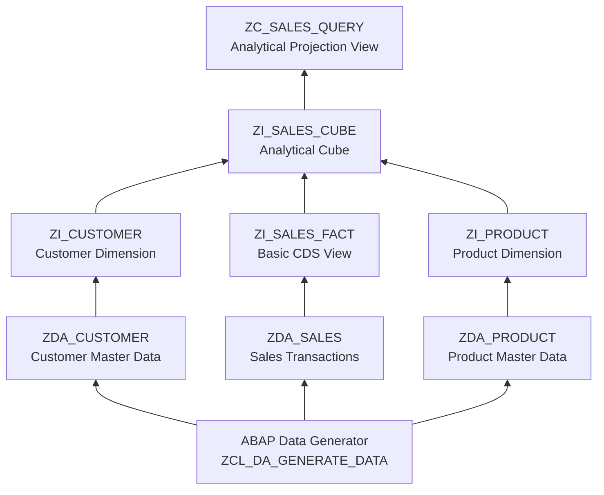

SAP Sales Performance Analytics | ABAP CDS
An end-to-end analytical modeling project built from scratch using ABAP CDS View Entities and CDS-based Analytical Projection Views. The project demonstrates how raw transactional data can be transformed into a reusable analytical model and consumed through a multidimensional query.
🎯 Project Objective
Bridge SAP ABAP development and SAP Data & Analytics by implementing a complete analytical modeling scenario, from custom database tables to a business-facing analytical query.
The solution enables business users to:
Analyze sales revenue, cost, and sold quantity.
Compare sales performance across customers and products.
Explore sales by transaction date.
Dynamically drill down and filter analytical results.
Reuse a central analytical cube for different reporting requirements.
🏗️ Solution Architecture

The model separates physical data storage, reusable CDS views, analytical modeling, and query consumption.
Technologies & Tools
ABAP Development Tools (ADT) for Eclipse
ABAP and ABAP SQL
ABAP Dictionary database tables
CDS View Entities
CDS analytical dimensions and cubes
CDS Analytical Projection Views (`analytical_query`)
SAP analytical engine
Data Model
The project uses synthetic sales data for an electronics business in Egypt. Each fact record represents a sales transaction for a single product. Customer and product master data provide descriptive attributes for analytical navigation.
Database table	Purpose	Sample records
`ZDA_CUSTOMER`	Customer ID, name, region, country	3
`ZDA_PRODUCT`	Product ID, name, category	2
`ZDA_SALES`	Sales ID, customer, product, date, quantity, revenue, cost, currency	6
Customer-to-sales and product-to-sales relationships are one-to-many. All sample monetary amounts use EGP, and quantity represents individual pieces.
Implementation
1. Database Tables
Created three custom transparent database tables using ABAP DDL in Eclipse ADT, defining primary keys, master data attributes, transactional fields, and currency references.
2. Sample Data Generation
Created `ZCL_DA_GENERATE_DATA`, an executable ABAP class implementing `IF_OO_ADT_CLASSRUN`.
The class populates master and transactional data using ABAP SQL `MODIFY`, allowing existing sample records to be updated on subsequent executions without duplicate-key insert errors.
3. Basic CDS View
Created `ZI_SALES_FACT` as a CDS View Entity on `ZDA_SALES`.
This layer exposes transactional fields with meaningful aliases and defines currency semantics for revenue and cost.
4. Analytical Dimensions
Created two reusable analytical dimensions:
CDS entity	Key	Descriptive attributes
`ZI_CUSTOMER`	`CustomerID`	CustomerName, Region, Country
`ZI_PRODUCT`	`ProductID`	ProductName, Category
Key annotations:
`@Analytics.dataCategory: #DIMENSION`
`@ObjectModel.representativeKey`
`@ObjectModel.text.element`
`@Semantics.text`
5. Analytical Cube
Created `ZI_SALES_CUBE` on top of `ZI_SALES_FACT`.
The cube connects transactional data to customer and product dimensions using CDS associations and foreign key annotations.
Measure	Default aggregation
NetAmount	SUM
CostAmount	SUM
Quantity	SUM
Key annotations:
`@Analytics.dataCategory: #CUBE`
`@ObjectModel.foreignKey.association`
`@Aggregation.default: #SUM`
`@Semantics.amount.currencyCode`
The analytical engine aggregates measures based on the selected drill-down dimensions rather than a fixed SQL `GROUP BY` in the cube.
6. Analytical Projection View
Created `ZC_SALES_QUERY` as a transient CDS View Entity using the `analytical_query` provider contract.
```abap
@AccessControl.authorizationCheck: #NOT_ALLOWED
@EndUserText.label: 'SALES PERFORMANCE QUERY'

define transient view entity ZC_SALES_QUERY
  provider contract analytical_query
  as projection on ZI_SALES_CUBE
{
  // Dimensions
  @AnalyticsDetails.query.axis: #ROWS
  CustomerID,

  @AnalyticsDetails.query.axis: #FREE
  ProductID,

  @AnalyticsDetails.query.axis: #FREE
  SalesDate,

  // Measures
  @AnalyticsDetails.query.axis: #COLUMNS
  NetAmount,

  @AnalyticsDetails.query.axis: #COLUMNS
  CostAmount,

  @AnalyticsDetails.query.axis: #COLUMNS
  Quantity,

  Currency
}
```
The query defines the initial analytical layout while allowing users to navigate the available dimensions.
Axis	Purpose	Fields
`#ROWS`	Initial row dimension	CustomerID
`#COLUMNS`	Display the measure structure horizontally	NetAmount, CostAmount, Quantity
`#FREE`	Dimensions available for drill-down and filtering	ProductID, SalesDate
The analytical projection view is consumed through the analytical runtime rather than directly through ABAP SQL.
📊 Analytical Results
The following results are expected based on the six sample transactions.
Sales Performance by Customer
Customer	Net Revenue (EGP)	Cost (EGP)	Quantity
C001 – Nile Trading	29,000	20,000	6
C002 – Delta Electronics	25,000	18,500	2
C003 – Upper Egypt Store	6,000	4,000	1
Total	60,000	42,500	9
Sales Performance by Product
Product	Net Revenue (EGP)
P001 – Laptop	37,000
P002 – Monitor	23,000
Total	60,000
Sales Performance by Month
Month	Net Revenue (EGP)
January 2026	35,000
February 2026	25,000
Total	60,000
Monthly totals are calculated from the sample transactions; a dedicated calendar month dimension is not yet implemented.
Dynamic Analytical Navigation
Moving `ProductID` from the free axis to the row axis changes the aggregation granularity from customer level to customer-product level.
CustomerID	ProductID	Net Revenue (EGP)
C001	P001	12,000
C001	P002	17,000
C002	P001	25,000
C003	P002	6,000
Total		60,000
The underlying data and total revenue remain unchanged; only the analytical grouping and presentation change.
How to Run
Use an SAP ABAP development or sandbox system that supports CDS View Entities and the `analytical_query` provider contract.
Create and activate `ZDA_CUSTOMER`, `ZDA_PRODUCT`, and `ZDA_SALES`.
Create and activate `ZCL_DA_GENERATE_DATA`.
Execute the class as an ABAP Console Application in ADT (`F9`).
Verify the sample records using Data Preview.
Create and activate `ZI_SALES_FACT`, `ZI_CUSTOMER`, and `ZI_PRODUCT`.
Create and activate `ZI_SALES_CUBE`.
Create and activate `ZC_SALES_QUERY`.
Open the query in an analytical preview or Multidimensional Analysis (MDA) tool, where supported by the SAP release and configuration.
Experiment with the row, column, and free axes to explore the results.
Key Learning Outcomes
Building custom SAP database tables and generating sample data with ABAP.
Designing a reusable fact-and-dimension analytical model.
Implementing CDS associations and analytical annotations.
Defining measure aggregation and currency semantics.
Separating analytical data modeling from query consumption.
Understanding multidimensional navigation and dynamic aggregation.
Applying ABAP development skills to SAP Data & Analytics scenarios.
Future Enhancements
Calculated measures for gross profit and profit margin.
Restricted measures for period-specific sales analysis.
Query variables and mandatory filters.
Calendar dimensions for monthly and yearly reporting.
Currency conversion and exception aggregation.
Analytical structures and CDS access control.
Integration with SAP Datasphere or SAP Analytics Cloud, subject to system access.
References
SAP Learning – Developing Analytical Models with CDS-based Analytical Projection Views
SAP Help Portal – ABAP Analytics
SAP Developers – Create an ABAP Database Table
Project Status
Completed: database tables, sample data generator, basic CDS view, analytical dimensions, analytical cube, and analytical projection view.
This is an independent learning and portfolio project using synthetic data, not a production implementation. Authorization is simplified for training, and advanced analytical features are listed as future enhancements.
Author
Omar Oun  
SAP ABAP Consultant | SAP Data & Analytics
LinkedIn · GitHub
